# Snooker Club Pro

A snooker club management system: tables, live sessions with automatic billing, bookings,
customers, payments, reports, and optional inventory and matches.

**Stack:** HTML · CSS · JavaScript · Node.js · Express · MongoDB (Mongoose) · Chart.js

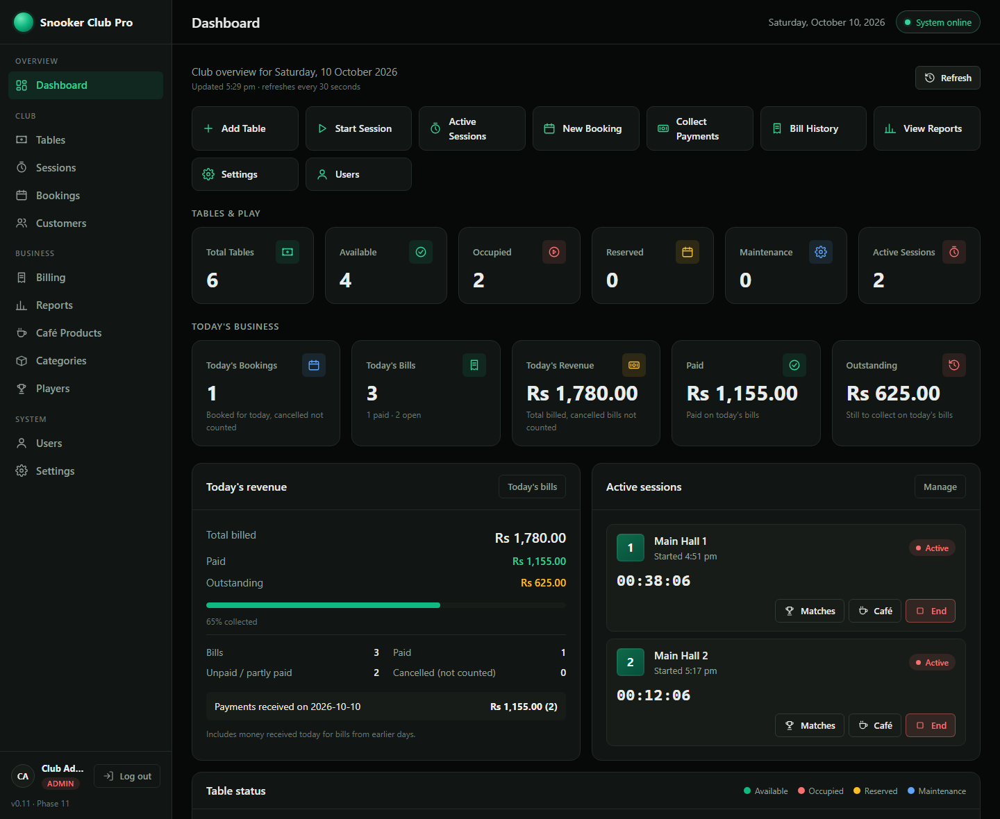

## Screenshots

*All screenshots use demo data.*

| | |
|---|---|
| **Tables:** live timers, start and end sessions<br>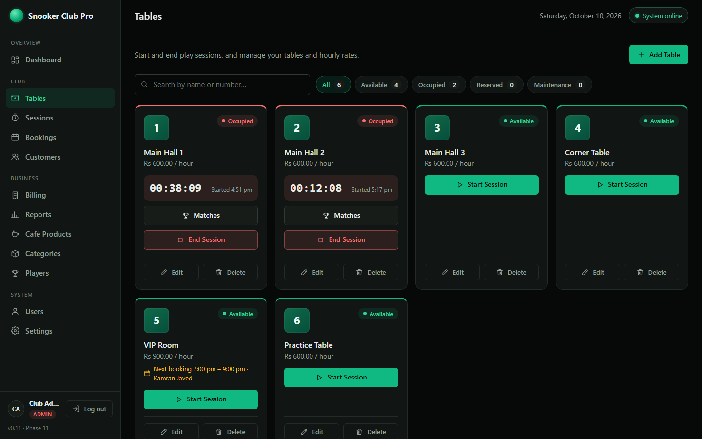 | **Sessions:** running sessions and history<br>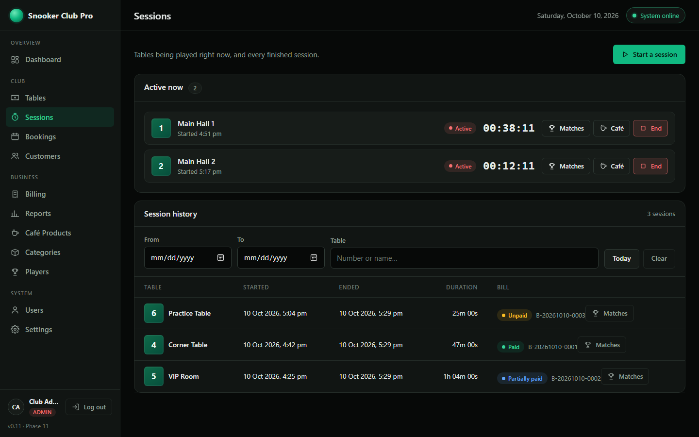 |
| **Billing:** bills, payments and balances<br>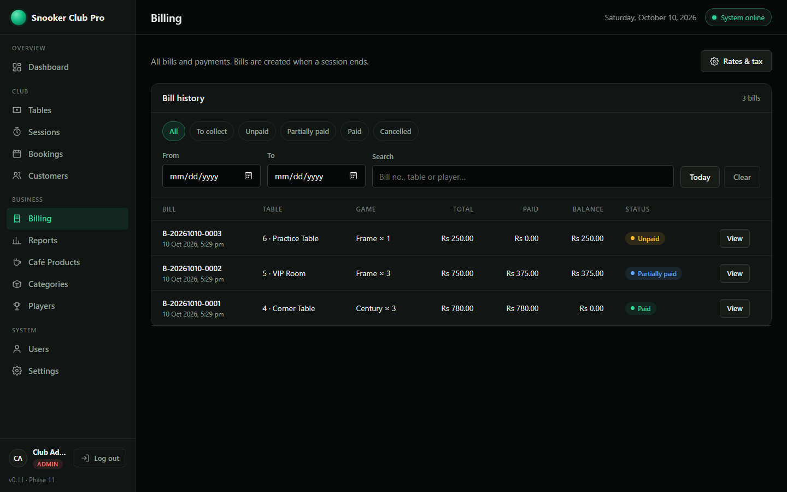 | **Bookings:** day view and check-in<br>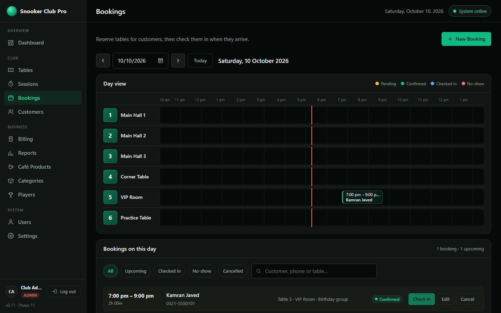 |
| **Reports:** revenue, payments, charts, CSV<br>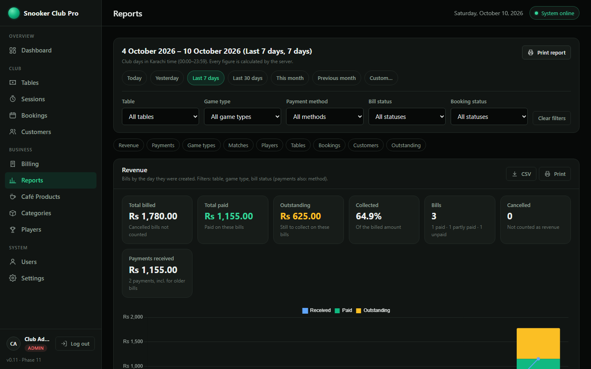 | **Café Products:** prices, stock, low-stock warning<br>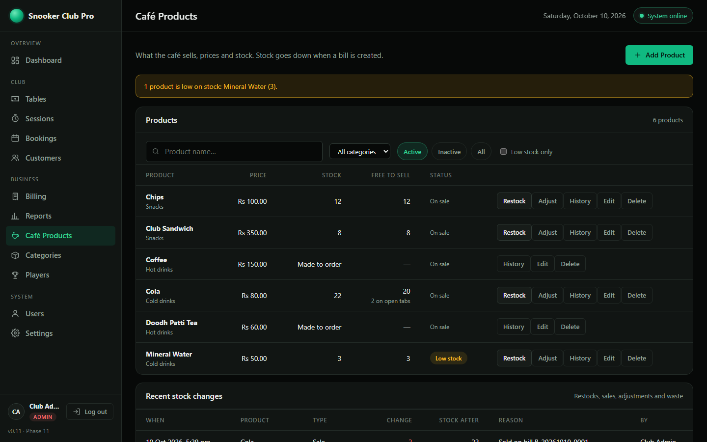 |
| **Players:** registered players and history<br>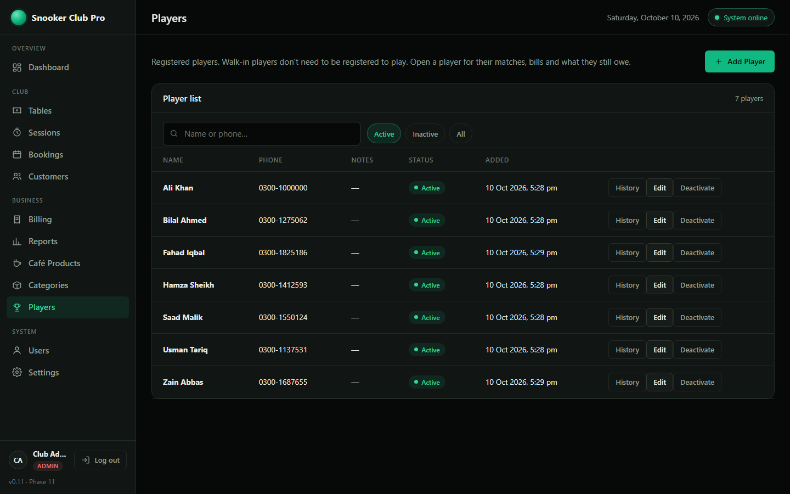 | **Settings:** rate list, time rule, tax<br>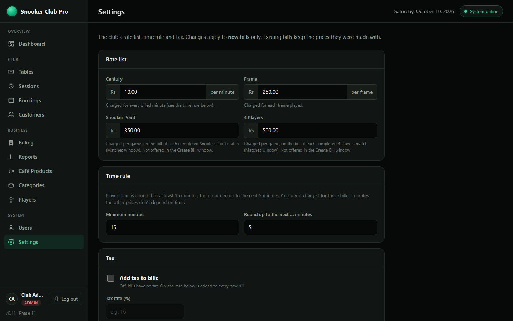 |
| **Backup (XML):** every N hours, Backup Now, download<br>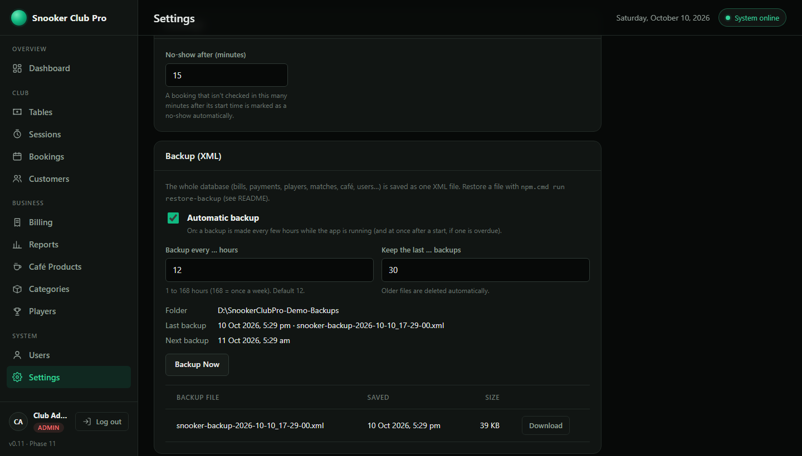 | **Login**<br>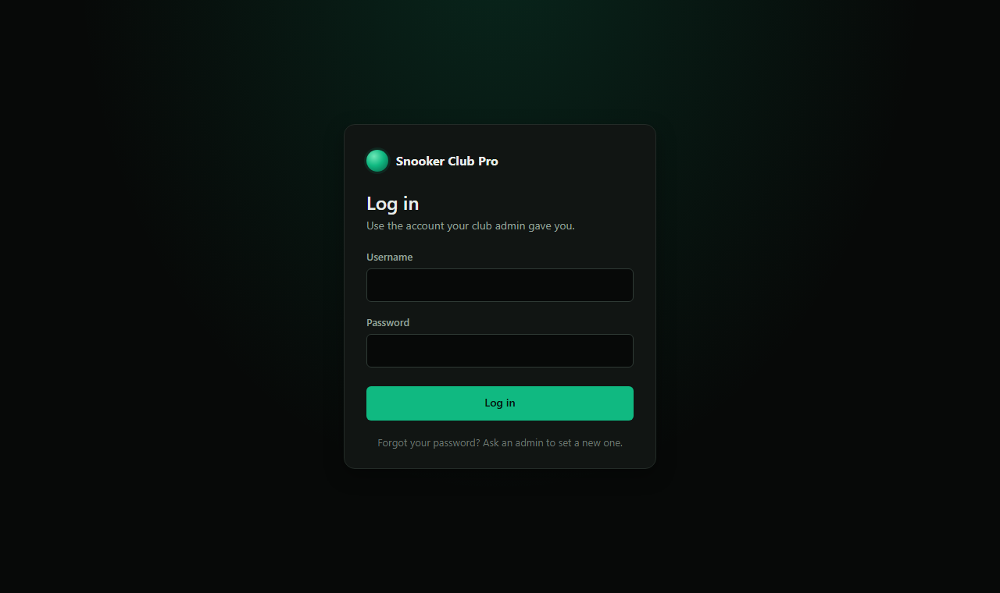 |

<p align="center">
  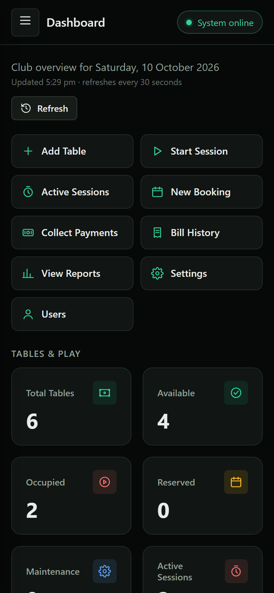<br>
  <em>Works on phones and tablets too</em>
</p>

## Status

| Phase | | Status |
|---|---|---|
| 1 | Architecture & folder structure | ✅ Done, see [docs/ARCHITECTURE.md](docs/ARCHITECTURE.md) |
| 2 | Setup & foundation | ✅ Done |
| 3 | Table management | ✅ Done |
| 4 | Sessions (start/end, live timers, history) | ✅ Done |
| 5 | Billing & payments (century/frame bills, who pays, café items, payments, receipts, rate list) | ✅ Done |
| 6 | Dashboard (live business overview) | ✅ Done |
| 7 | Customers & table bookings (day view, check-in, auto no-show) | ✅ Done |
| 8 | Login, users & roles (admin / staff / cashier) | ✅ Done |
| 9 | Reports & business analytics (charts, CSV export, print) | ✅ Done |
| 10 | Café products & inventory (categories, products, stock, session café tab, café payer rules) | ✅ Done |
| 11 | Players & matches: 11.1 game-mode list ✅ · 11.2 players ✅ · 11.3 game prices ✅ · 11.4 matches ✅ · 11.5 match billing ✅ · 11.6 café & player billing ✅ · 11.7 match & player reports ✅ · 11.8 final checks ✅ | ✅ Done |

---

## Requirements

| Tool | Version | Check with |
|---|---|---|
| Node.js | 20 or newer | `node --version` |
| MongoDB | 7 or newer | see below |

### MongoDB on this PC (portable, no installer)

MongoDB 9.0.2 is installed **without** an installer (no admin rights needed):

| What | Where |
|---|---|
| Program | `%LOCALAPPDATA%\SnookerClubPro\mongodb\bin\mongod.exe` |
| Club data | `%LOCALAPPDATA%\SnookerClubPro\mongo-data` ← back this folder up |
| MongoDB's own log | `%LOCALAPPDATA%\SnookerClubPro\mongo-logs\mongod.log` |

It is **not** a Windows service, so it must be started before the app (see below).
Other locations can be set with `MONGOD_PATH` / `MONGO_DATA_DIR` in `.env`.

## First-time setup

Open a terminal in the `Snooker-Club-Pro` folder:

```powershell
npm install                    # downloads the packages listed in package.json
copy .env.example .env         # only if .env doesn't exist yet
```

If you just copied `.env.example`, put a long random value in `AUTH_SECRET` (it protects logins):

```powershell
node -e "console.log(require('crypto').randomBytes(48).toString('hex'))"
```

Copy the printed text into `.env` as `AUTH_SECRET=…`. Never share it and never put it in Git.

### Create the first admin (one time)

With the database running (`npm run db`, see below):

```powershell
npm run create-admin
```

It asks for a full name, a username and a password (typed twice; nothing is shown while you type).
The password needs **at least 10 characters with letters and numbers**, and must not contain the username.
The command refuses if an active admin already exists. After that, the admin adds everyone else
on the **Users** page.

### Forgot the admin password? (Phase 11.8)

Another admin can set a new password on the **Users** page. If nobody can log in as an admin, run this
on the club PC, with the database running:

```powershell
npm.cmd run reset-admin-password
```

- It lists the active admins and asks which one (press Enter when there is only one).
- It asks for the new password twice. Nothing is shown while you type, and the password is never printed or saved anywhere except as a secure hash. The same password rules apply as everywhere else.
- Every login of that admin ends at once (old browser logins stop working). Log in again with the new password.
- It only changes an existing, **active admin**. It never creates a user and never changes staff or cashier accounts. With no active admin at all it stops and tells you to use `npm.cmd run create-admin`.

## Run the app (two terminals)

**Terminal 1: database** (leave it open)
```powershell
npm run db
```

**Terminal 2: app**
```powershell
npm run dev
```

Then open **http://localhost:3000**.

- `npm run dev` restarts automatically when you save a file in `server/` (uses nodemon).
- `npm start` runs without auto-restart (for the real club PC).
- Stop either one with **Ctrl + C** (stop the app first, then the database).

You should see:

```text
MongoDB connected: 127.0.0.1:27017/snooker_club_pro
Server running at http://localhost:3000  (development)
```

### First time in the app

1. **Log in** with the admin you created (`npm run create-admin`).
2. **Users** → add accounts for your staff and cashiers.
3. **Settings** → check the **rate list**. A new club starts with Century Rs 10 per minute, Frame Rs 250, Snooker Point Rs 350 and 4 Players Rs 500. Change them to your prices.
4. **Tables** → add your tables.
5. **Start Session** on a table. Record games as **Matches** (Matches button) if you want one bill per game, or just let them play.
6. **End Session**. A session played as matches opens its **Matches** window: create one bill per completed match there (every game type). A session without matches opens the **Create Bill** window straight away (Century or Frame).

## Logins and roles

Everyone logs in at `/pages/login.html` (opening any page while logged out goes there first).

| | Admin | Staff | Cashier |
|---|:-:|:-:|:-:|
| Dashboard, Tables, Sessions, Customers, Bookings (view + manage) | ✅ | ✅ | ✅ |
| Create and view bills, print receipts | ✅ | ✅ | ✅ |
| View payments | ✅ | ✅ | ✅ |
| Record payments (also part payments), cancel unpaid bills | ✅ | ❌ | ✅ |
| Reports (all business reports, CSV export, print) | ✅ | ✅ | ❌ |
| Café: see products and stock, sell (session café tab, café items on bills) | ✅ | ✅ | ✅ |
| Café: restock (goods received), see stock history | ✅ | ✅ | ❌ |
| Café: categories, products, prices; stock corrections and waste | ✅ | ❌ | ❌ |
| Players: see the player list | ✅ | ✅ | ✅ |
| Players: register and edit | ✅ | ✅ | ❌ |
| Players: deactivate / reactivate (players are never deleted) | ✅ | ❌ | ❌ |
| Players: history (matches, bills, outstanding) | ✅ | ✅ | ✅ |
| Matches: see, start, complete, change an unpaid result | ✅ | ✅ | ✅ |
| Matches: cancel a match | ✅ | ✅ | ❌ |
| Matches: change the result once the match's bill has payments | ✅ | ❌ | ❌ |
| Settings: change (rates, tax, time rule, no-show minutes) | ✅ | ❌ | ❌ |
| Settings: see the rates (the bill windows need them) | ✅ | ✅ | ✅ |
| Users (add, edit, roles, activate/deactivate, set passwords) | ✅ | ❌ | ❌ |

- **The server checks every request.** Hidden menu items and buttons are only for convenience.
- `401` = not logged in (or the login expired); `403` = logged in, but your role may not do this.
- A login lasts `SESSION_TTL_HOURS` hours (default 12), then the user logs in again.
- **Safety rules:**
  - The last active admin can never be deactivated or lose the admin role.
  - An admin can't deactivate their own account or remove their own admin role.
  - A deactivated user is logged out everywhere at once and can't log in.
  - After a new password is set, the user's other logins end.
- **Brute-force protection:** 5 wrong passwords for one username (or 20 from one computer) within
  15 minutes → that login is blocked for 15 minutes. The error never says whether the username exists.
- **Who did what** is saved with the records: bill created or cancelled by, payment received by,
  booking created, cancelled or checked in by, session started or ended by, settings changed by, and user created or changed by.
- **Forgot password?** An admin sets a new one on the Users page. If the **only** admin forgot theirs,
  see Troubleshooting.

The role rules live in one file: `server/config/permissions.js`.

## Reports

**Reports** (sidebar → Business) shows business figures for a period. Admin and staff can open it; cashiers can't
(the server refuses both the page and the API with 403).

**Choosing the period:** Today · Yesterday · Last 7 days · Last 30 days · This month (so far) · Previous month ·
Custom (From and To dates, both included, up to 366 days). A day is a **club day in Karachi time** (00:00–23:59),
decided by the server, never by the computer's own clock. **Filters:** table, game type, payment method,
bill status, booking status. The game type filter offers all four game types (Phase 11.7). Each report says which filters it uses; Matches and Players use table and game type. The choice stays in the address bar, so a
refresh or a shared link shows the same report.

| Report | What it shows | How it is counted |
|---|---|---|
| **Revenue** | Total billed, paid, outstanding, % collected; bills (paid, partly paid, unpaid, cancelled); payments received; a chart and a row per day | Bills belong to the day they were **created**. Amounts are the totals **saved on each bill**, so changing Settings never changes an old report. **Cancelled bills are never revenue** (only counted). "Received" = money taken that day, for any bill |
| **Payments** | Number and amount per method (Cash, Card, JazzCash, Easypaisa, Bank transfer, Other); total; money received for bills from **before** the period | Real payment records, by the day received |
| **Game types** | Bills, games/frames, game charges, café, total billed, average bill per game type | Grouped by the game types **stored on the bills**: all four types (Century, Frame, Snooker Point, 4 Players) once they have bills. Types with no bills in the period are not shown |
| **Matches** (Phase 11.7) | Matches, completed / cancelled / in progress, billed / not billed / bill cancelled, money of their bills (billed, paid, outstanding), registered vs walk-in places; a row per game type (**all four**); then every match: number, start time, table, game type, players, winner or winning team, status, bill number, bill status and amount (25 per page); sort newest / oldest | Matches that **started** in the period, each with its own bill **whatever day the bill was made**. Only real matches: old and whole-session bills never get a match |
| **Players** (Phase 11.7) | Per registered player: matches played, wins, losses, win %, bills, billed (their share), paid, outstanding; one line for all walk-ins; money totals; sort by matches / wins / billed / outstanding / name (25 per page). A name opens the player's history | Matches: **completed** matches that started in the period. Money: **match bills created** in the period, the player's **own** share only, the same rule as the player's history (a team-mate's debt is never theirs; cancelled bills owe nothing). Walk-ins never become players; old and whole-session bills keep names only and are not counted per player |
| **Table performance** | Sessions, completed, played time, average session, billed time, revenue, time in use, **Observed Utilization**; sort by revenue / sessions / billed time / table number | Sessions that **started** in the period, with their bills (cancelled bills not counted). The table's hourly rate is not used |
| **Bookings** | Total, pending, confirmed, checked in, cancelled, no-show; check-in / no-show / cancellation rates; a row per day | Bookings that **start** in the period. Checking in completes a booking, so "checked in" = "completed". Rates = checked in / no-show / cancelled ÷ bookings with a known outcome (checked in + cancelled + no-show); pending and confirmed are not included. **Booking status filter:** with one status selected, the totals, the daily rows and the CSV show only that status, and the rates show "—" ("Rates are shown only when All statuses is selected."), because a status divided by itself would always be 100% |
| **Customers** | New customers, customers with bookings, who checked in, repeat customers (2+ check-ins), top 10 by bookings and by sessions | From bookings only (see limitation below) |
| **Outstanding bills** | Unpaid and partly paid bills with remaining amounts; total outstanding; sort oldest / newest / largest balance; "All dates" | The bill's own `total − amountPaid` (the same rule as the Billing page) |

**Observed Utilization (an estimate):** *"Percentage of the selected period represented by recorded table use.
This is an estimate because club opening hours and maintenance/closure time are not stored."*
- **Calculation:** recorded session time on the table inside the period ÷ the period's elapsed clock time (from when the table was added, up to now if the period isn't over).
- **Sessions:** a session across midnight is split between the days; a running session counts up to now.
- **What it doesn't use:** billed minutes, the table's hourly rate and bookings. Opening hours and maintenance/closure time aren't stored, so none are assumed.
- **Why it reads low:** every hour of the period counts as available, so the figure is lower than a utilization based on opening hours would be.
- **Deleted tables** keep their history but get no percentage (their add date is gone).

Exact rules: `docs/API.md`, "Reports".

**Customer limitation:** bills store free-text player names and are **not linked** to customer records
(a Phase 7 decision), so there is **no revenue per customer**, and names are never matched up by guessing.
A session counts for a customer only when it was started by checking in that customer's booking.

**CSV export** (the **CSV** button on Revenue, Payments, Game types, Matches, Players, Table performance, Bookings, Outstanding)
downloads exactly what is selected (same period and filters). It opens in Excel with correct characters. Text that
could act as a spreadsheet formula (e.g. starting with `=`) is made harmless. Phone numbers, notes, passwords and
login data are never exported.

**Print:** **Print report** prints every report; the **Print** button on a section prints only that section.
The paper version has the period, the filters, the date and who printed it.
- **Outstanding bills** show 25 per page on screen, but Print always prints **every** matching bill (same filters as the screen and the CSV), with the count and the total outstanding.
- Printing is limited to **2,000** bills (about 60–80 pages). Above that the page says *"There are too many outstanding bills to print at once…"* and suggests narrowing the period or filters, or using CSV (limit 50,000).
- If the bills can't be loaded, nothing is printed.
- **Matches** and **Players** print the page shown on screen (25 rows); the note under the list says so, and their CSV has every row.

**Sessions vs Observed Utilization (Table performance):** they count days differently, on purpose.
- **Sessions** are counted once, on the day the session **started**.
- **Observed Utilization** splits the recorded time across the calendar days it actually happened.
- Example: a 23:00–01:00 session shows Sessions 1 and 1 h on the first day, and Sessions 0 and 1 h on the next.

## Café products & inventory

**Café Products** and **Categories** are in the sidebar (Business section).

**Categories** (e.g. Cold drinks, Snacks):
- Names are trimmed and must be unique; capital letters don't matter.
- A category that still has products can't be deleted.

**Products:**
- Each product has a category, a price (Rs, with paisa), a status (active or inactive), and **Count stock** on or off.
- Switch Count stock off for things made to order (tea, coffee): those are never "out of stock".
- The same name can't be used twice in one category.
- A product that has ever been sold or restocked can't be deleted. Set it **inactive** instead: it leaves the sale lists but keeps its history.

**Stock:**
- Stock is never edited directly. Every change is recorded in the product's **History**, with who did it and the stock after:
  - **Restock** (admin, staff)
  - **Adjust** (admin): a correction after counting (+/−), or waste (broken or expired)
  - **Sales** and **cancelled sales**, recorded automatically
- Stock can never go below 0.
- A **low-stock warning** appears when a product is at or below its warning level (default 5).

**Selling** (every role):
- **During the game:** on a running session (Sessions page, Dashboard), press **Café** to put items on the table's tab: products from the list, or a typed-in one-off item. Optionally note who had each item.
  - An item can only be added if enough is free (stock minus what's already on other open tabs).
  - The price is fixed when the item is added.
- **In the Create Bill window:** the tab's items are listed automatically, and more items can be added there (from the list, or typed in).
  - **Who pays for the café:** *Loser Pays*, *Consumer Pays* (each player pays for the items they had; choose "who had it" for each) or *Both Pay* (called *Split equally* before Phase 11.5).
  - The game part still follows the normal "Who pays".
- **Stock is taken off when the bill is created**, all at once and never below 0. If two tables race for the last item, one bill gets it and the other is told what's short.
- **Cancelling a bill before any payment puts the stock back.**
- Old bills never change: they keep the name, price and category each item had.

Walk-in café sales without a table session are not part of this version.

## Players and matches (Phase 11)

**Players** (sidebar → Business) lists the club's **registered** players:
- **Search** by name or phone.
- **Add** a player (name, optional phone and notes), **edit**, and **deactivate / reactivate**.
- **Names are unique**, without looking at capital letters ("Ali" and "ali" are the same registered name).
- Players are separate from the customers used for bookings.
- Walk-in players don't need to be registered to play: they are typed in by name in a match.
- Players are never deleted, so their history stays complete.

### Game prices (Phase 11.3)

An admin sets one price per game type in **Settings → Rate list**:

| Game type | Price | How the bill line is worked out |
|---|---|---|
| Century | Rs ___ per minute (default Rs 10) | **billed minutes × rate**, using the same time rule as every bill (15 min minimum, then up to the next 5 min) |
| Frame | Rs ___ per frame (default Rs 250) | frames × rate, as before |
| Snooker Point | Rs ___ per game (default Rs 350) | 1 × rate, on the bill of each completed Snooker Point match (Matches window) |
| 4 Players | Rs ___ per game (default Rs 500) | 1 × rate, on the bill of each completed 4 Players match (Matches window) |

- **Examples (Rs 10 per minute):** a 47-minute century session is billed 50 minutes, so Rs 500. A 7-minute one is billed the 15-minute minimum, so Rs 150.
- **Games played:** the bill window still asks how many century games were played. Reports count them, but the price depends only on time.
- **Old bills never change:** a bill keeps the rate and pricing it was made with. Century bills made before this update stay "games × price per game".
- **Price of Rs 0:** switches a game type off, and its bills are refused.
- **Older settings:** if the club had a Frame price saved before this update, it is kept as the Frame rate. The old per-game century price is kept in the database but no longer used.

### Matches (Phase 11.4)

```
Table → Session → Match → Players → Result → Bill → Payment
```

- **Open the matches:** click **Matches** on a running session. It is on the table card (Tables page), the session row (Dashboard and Sessions page), and in Sessions history for ended sessions.
- **Many matches per session:** a session can have any number of matches, numbered #1, #2, #3… One frame is one match, so another frame is another match. The session stays the clock: matches have no timer of their own.
- **Start New Match:**
  1. Choose the game type.
  2. Add the players. Each one is a **Registered Player** (searched from the Players list) or a **Walk-in Player** (just a name; nothing is registered for them).
  - The same registered player can't be added twice to one match, but can play in any number of matches.
- **Players per game type:**

  | Game type | Players |
  |---|---|
  | Century | 2 or more |
  | Frame | 2 or more |
  | Snooker Point | exactly 3 |
  | 4 Players | exactly 4, as Team 1 and Team 2 with 2 players each ("Move to Team 2" swaps a player) |
- **Complete Match:** choose who won, or for 4 Players the winning team. The list then shows "Winner: Ali" or "Winning Team: Team 2".
  - **Change result** corrects a completed match later.
  - Once the match's bill has payments, only an admin can change the result. Changing it never changes a bill.
- **Cancel Match** (admin, staff) asks first. Cancelled and completed matches are never deleted.
- **After the session ends:** no new match can start, but matches still in progress can be completed or cancelled.
- **Snooker Point** records only the winner (no point-by-point scoring).
- **Player history:** see Phase 11.6 below.
- The **Create Bill** window (sessions without matches) offers Century and Frame only, on purpose. Snooker Point and 4 Players are always billed from their matches.

### Bills for matches (Phase 11.5)

**One bill per completed match.** A session with five matches gets five bills, and each can be paid on its own.
- **Where:** the session's **Matches** window. When a session that has matches is ended, this window opens instead of the old Create Bill window.
- **Billing line on each match:**
  - *Not billed* + **Create Bill**
  - *Bill B-… · Unpaid* + **View Bill**
  - *Not ready — match in progress*
  - *Cancelled — not billed*
- **The bill window** shows the match, game type, players and winner (or winning team). These come from the match and **can't be changed** there.
  - You choose who pays and, if the session has a café tab, who pays the café.
  - The server's preview shows the rate, minutes or quantity, game total, café total and grand total before you press **Create Bill**.
- **Prices:** today's rate from Settings, copied into the bill. Changing Settings later never changes it.

  | Game type | Bill |
  |---|---|
  | Century | the session's billed minutes × the Century rate (the session is the clock) |
  | Frame | 1 frame × the Frame rate. Another frame is another match with its own bill |
  | Snooker Point | 1 × the Snooker Point rate |
  | 4 Players | 1 × the 4 Players rate |
- **Who pays:** *Loser Pays*, *Winner Pays* or *Both Pay* (everyone).
  - When several players lose (or win), they share equally. For example, in 4 Players the losing team's two players pay half each.
  - Odd paisa go to the first payers, so the shares always add up exactly.
- **Café:** the session's open café tab goes onto the **next** match bill made (stock is taken then, once). Untick *Put the café tab on this bill* to leave it for a later match. The Phase 10 café rules (Loser Pays / Consumer Pays / Both Pay) are unchanged.
  - **The last billable match must take the café tab (Phase 11.8).** When no other match of the session can still be billed, the box stays ticked and locked, with the reason shown. The server refuses it too. Otherwise those items would never be billed and would keep holding stock.
  - "Another billable match" = a completed match without a bill, or one still in progress. A cancelled match, an already billed one, a second Century match (the session's time is charged once) and a game type priced Rs 0 don't count.
- **Rules:**
  - A match is billed only when it is **completed** and its session has **ended**.
  - A match gets **one** bill: if two people try at once, one gets the bill and the other is told.
  - Cancelling a match bill leaves the match completed. Like every cancelled bill, it isn't made again.
  - **Century is charged once per session:** the session's time can be on only one Century bill, so a second Century match in the same session can't be billed.
  - Changing a match's result later never changes its bill. Once that bill has payments (partly or fully paid), only an admin can change the result.
  - The bill itself is what counts (Phase 11.8). A match's bill is always found by the bill's own match reference, so the paid-bill rule, "already has a bill" and every list and report hold even if the match's link to its bill was never saved (that link is then repaired).
  - **"Billed per match: X of Y"** (Sessions history, Dashboard) counts matches whose bill is **not cancelled**, the same as the Matches report.
- **Sessions without matches** (and every older bill) work exactly as before, in the Create Bill window. A session that has matches can't also get a whole-session bill, and vice versa.

### Café consumers and player history (Phase 11.6)

```
Player → Match → Bill → Payment
Player → Café consumer → Bill
```

**Who had the café item:**
- In the match bill window, each café item's "Who had it?" list shows the match's players, e.g. *Ali (Registered)* or *Guest (Walk-in)*.
- **Consumer Pays:** each player pays for what they had. Example: Tea Rs 150 → Ali, Burger Rs 300 → Ahmed gives Ali Rs 150 and Ahmed Rs 300 for the café.
- A registered consumer is saved on the bill line with their player reference, plus the name. A walk-in is saved by name only: they don't need to be registered.
- "Who had it" on the café tab now takes up to 60 characters, so a registered player's full name fits.

**Player history** (Players page → **History**, every role):
- The player's name, phone, notes, active or inactive status, and:

  | Shows | Details |
  |---|---|
  | Totals | matches, wins, losses, bills, paid, **outstanding** |
  | Match history | match number and table, date and time, game type, team-mates and opponents, the result (for 4 Players also which team won), the match's bill and its status |
  | Billing history | bill number (opens the bill), date and time, game type and match, who pays, café items the player had, status, bill total, the player's share, what they paid, what they still owe |
- **Outstanding** = the player's own share minus what they paid, on unpaid and partly paid bills.
  - A paid bill gives Rs 0, and so does a cancelled bill.
  - In a shared bill, each player owes only their own part. For example, the two losers of a 4 Players match each owe Rs 250.
- **Everything is worked out from the matches, bills and payments.** Nothing is counted separately, so the history can't get out of step.
- **Only linked records:** the history uses the player's reference on matches and match bills.
  - Walk-in games, bills made in the Create Bill window and bills from before Phase 11.5 have names only.
  - They are **not** linked to a registered player, not even when the name is the same.
- **Renames:** renaming or deactivating a player never changes old matches or bills, which keep the name they were made with. An inactive player's history can still be opened.

## Backup and restore (XML)

The whole database is saved as **one XML file**: bills, payments, players, matches, sessions, tables, customers,
bookings, café, settings, bill numbers and users. Login sessions are not saved.

**Where:** the folder in `BACKUP_DIR` in `.env` (this PC: `D:\SnookerClubPro-Backups`).
- Keep it **off the C: drive**, so a broken Windows or system drive doesn't take the backups with it.
- Best: a **OneDrive / Google Drive** folder, so every backup is also copied to the cloud.
- When the folder is on the system drive, the Settings page warns about it.
- Files are named `snooker-backup-2026-10-10_21-00-05.xml` (club time).

**When:** set by an admin in **Settings → Backup (XML)**:

| Setting | Default | Meaning |
|---|---|---|
| Automatic backup | on | make backups by themselves |
| Backup every … hours | 12 | 1 to 168 hours (168 = once a week). A new value applies at once |
| Keep the last … backups | 30 | older files are deleted automatically |

- **Backup Now** makes a backup straight away.
- The page shows the folder, the last and the next backup, and any error.
- Every file can be **downloaded** there (e.g. to copy it to a USB drive).
- **Only while the app runs:** backups are made while `npm run dev` / `npm start` is running. After a start, an overdue backup (the app was off) is made within a minute.
- A file is complete or doesn't exist: it is written as `.xml.tmp` first and renamed only at the end.
- **Keep the files private:** they contain every record, including the users' password hashes (never the passwords).
- Only admins can see, make or download backups.

### Restore a backup

1. Stop the app (**Ctrl + C** in its terminal). Leave the database running (`npm.cmd run db`).
2. Run, with the full path of the file:
   ```powershell
   npm.cmd run restore-backup -- "D:\SnookerClubPro-Backups\snooker-backup-2026-10-10_21-00-05.xml"
   ```
   Without a file name it lists the backups in the folder.
3. It checks the whole file first and shows how many records each part has. A damaged or unfinished file changes nothing.
4. Type `RESTORE` to continue (anything else cancels).
5. The current data is saved first as `snooker-before-restore-….xml` in the backup folder (these are never deleted automatically), then replaced by the backup.
6. Start the app again. Everyone logs in again.

### If the PC breaks

1. On the new (or repaired) PC: install Node.js, MongoDB and copy the project folder (see First-time setup and Requirements).
2. Copy the newest backup file from the backup drive, USB or OneDrive.
3. `npm.cmd run db`, then `npm.cmd run restore-backup -- "<path of the file>"`.
4. `npm.cmd run dev` and log in with the users from the backup. No `create-admin` is needed.

## Run the tests

MongoDB must be running (`npm run db`). The tests use separate `snooker_club_pro_test…` / `…_uitest`
databases and delete them afterwards. Your real data is never touched.

```powershell
npm test                     # automated API + unit tests (server/tests)
npm run test:browser         # browser tests: every page clicked through in headless Edge/Chrome
npm run test:browser -- cafe # only some suites, in the order given (auth, billing, bookings, cafe, customers, dashboard, matchbills, matches, matchreports, playerhistory, players, reports, sessions, tables)
```

**How the browser tests work:**
- They run in `tests/browser/`, using the real app and a throw-away database.
- They need Microsoft Edge or Google Chrome. If it isn't found automatically, set `BROWSER_PATH`.
- Each suite starts from a fresh server state and a fresh browser profile, so suites never depend on each other.

## Settings (`.env`)

| Variable | Default | Meaning |
|---|---|---|
| `PORT` | `3000` | web server port |
| `MONGODB_URI` | `mongodb://127.0.0.1:27017/snooker_club_pro` | database address and name |
| `CLUB_TIMEZONE` | `Asia/Karachi` | the club's timezone: decides what "a day" is in date filters (times are stored in UTC) |
| `MONGOD_PATH` | *(empty = default above)* | where `mongod.exe` is (only for `npm run db`) |
| `MONGO_DATA_DIR` | *(empty = default above)* | where the data is stored (only for `npm run db`) |
| `NODE_ENV` | `development` | `production` on the real club PC |
| `AUTH_SECRET` | *(required)* | long random secret that protects logins (at least 32 characters). In `development` a missing one only gives a warning and a temporary secret; in `production` the app refuses to start |
| `SESSION_TTL_HOURS` | `12` | hours a login stays valid (1–720) |
| `BACKUP_DIR` | *(empty = `%LOCALAPPDATA%\SnookerClubPro\backups`)* | folder for the XML backups. Use another drive, a USB drive or a OneDrive folder (see "Backup and restore") |
| `COOKIE_SECURE` | `false` (in `production`: `true`) | `true` = the login cookie is only sent over HTTPS. With `NODE_ENV=production` on plain http (the club network), set `COOKIE_SECURE=false`, or logins won't stick |
| `TRUST_PROXY` | *(empty = no proxy, the club PC)* | *optional, only for hosting behind a proxy (e.g. Railway).* How many proxies sit in front of the app, so the login lock sees the visitor's real address instead of the proxy's. See `docs/POSTGRES_MIGRATION.md` |
| `ALLOWED_ORIGINS` | *(empty = only this site's own pages)* | *optional, only for hosting the frontend elsewhere (e.g. Vercel).* Comma list of exact `https://…` addresses besides this site's own that may send changes. See `docs/POSTGRES_MIGRATION.md` |
| `DATABASE_URL` | *(empty = unused)* | *optional PostgreSQL foundation, Phase 2 - not used by the running app yet.* The real database today is still `MONGODB_URI` above. See `docs/POSTGRES_MIGRATION.md` |

## Troubleshooting

| Message | Fix |
|---|---|
| `Could not connect to MongoDB (127.0.0.1:27017/…)` | The database isn't running: start it with `npm.cmd run db` in another terminal (the address is shown without any password) |
| `MongoDB connected (…), but updating the database indexes failed` | The database works, but a rule (index) couldn't be built on the existing data, e.g. two records with the same value. No data was changed. Note the message and ask the developer |
| `port 27017 is already in use` (from `npm run db`) | MongoDB is already running, so just start the app |
| `Port 3000 is already in use` | The app is already running in another terminal, or change `PORT` in `.env` |
| Top bar shows **Database offline** | The database terminal was closed. Run `npm run db` again; the app reconnects by itself |
| Top bar shows **Server offline** | The app isn't running. Run `npm run dev` |
| Every page goes to the login page | Normal when logged out. No account yet? Run `npm run create-admin` |
| "Too many login attempts. Please wait…" | Wait 15 minutes, or restart the app (the counter is kept in memory) |
| The only admin forgot their password | Run `npm.cmd run reset-admin-password` on the club PC (see "Forgot the admin password?"). Never edit the database by hand |
| Settings → Backup shows "The last backup failed" | Check that the `BACKUP_DIR` drive is connected (USB) and has free space. A failed timed backup is tried again after 15 minutes; **Backup Now** tries at once |
| "The backup file is damaged or incomplete" (restore) | Nothing was changed. Use an older backup file |
| "AUTH_SECRET is missing or too short" | Put a long random `AUTH_SECRET` in `.env` (see First-time setup) |

## Known limitations

These are true for this version (checked in Phase 11.8):

| Area | Limitation |
|---|---|
| Café | Café items are sold on a **table session's** café tab. Walk-in café sales without a session are not possible. |
| Refunds | There is no refund workflow. A bill with payments can't be cancelled, and a recorded payment can't be reversed in the app. |
| Snooker Point | Only the winner is recorded (no point-by-point scoring). |
| Customers and players | Booking customers and registered players are separate lists. Bills keep free-text player names, so there is **no revenue per customer**. Bills made in the Create Bill window and bills from before matches existed are not counted for any registered player (names are never matched up). |
| Century | A session's time can be charged on **one** Century bill only. A second Century match in the same session can't be billed (a cancelled Century bill still counts, because cancelled bills aren't made again). |
| Create Bill window | Offers **Century and Frame** only, on purpose. Snooker Point and 4 Players are billed from their completed matches. |
| Reports | **Matches** and **Players** print the page shown on screen (25 rows); their **CSV** has every row. |
| Login throttle | The "too many attempts" counter is kept in memory, so restarting the app clears it. |
| Club settings | The currency (Rs) and the club timezone shown on pages (Asia/Karachi) are fixed in the app. The server's day rules follow `CLUB_TIMEZONE` in `.env`. |

## Documentation

- [docs/ARCHITECTURE.md](docs/ARCHITECTURE.md): how the project is organised and why
- [docs/API.md](docs/API.md): every API endpoint with examples

## Project status

**Phase 11 — COMPLETE** (version 0.11.0)  
**Phase 11.8 — FINAL CHECKS COMPLETE**: bug fixes, security hardening, documentation and the full test run (server tests, and every browser suite in normal and reverse order).
